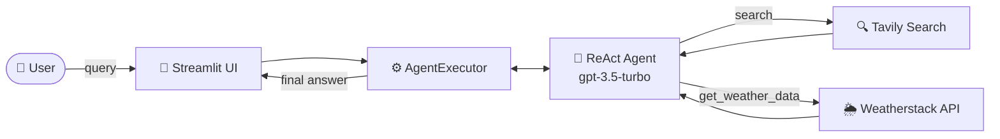

<div align="center">

# 🌦️ Weather-AI-agent-using-Langchain

### A ReAct agent that searches the web and checks the weather — built with LangChain, OpenAI and Streamlit

*Ask a question in plain English. The agent decides which tools to use, runs them, and combines the results into one answer.*

[](https://www.python.org/)
[](https://www.langchain.com/)
[](https://platform.openai.com/)
[](https://streamlit.io/)
[](LICENSE)
[](#-contributing)
[](https://github.com/lucky0731/Weather-AI-agent-using-Langchain/stargazers)

[✨ Features](#-features) •
[🚀 Quickstart](#-quickstart) •
[🏗️ Architecture](#️-architecture) •
[🤝 Contributing](#-contributing) •
[💬 Support](#-support)

</div>

---

## 📖 Table of Contents

- [🌟 Overview](#-overview)
- [✨ Features](#-features)
- [📸 Demo](#-demo)
- [🏗️ Architecture](#️-architecture)
- [⚙️ How It Works](#️-how-it-works)
- [💡 Example Queries](#-example-queries)
- [🧰 Tech Stack](#-tech-stack)
- [📋 Prerequisites](#-prerequisites)
- [🚀 Quickstart](#-quickstart)
- [🔐 Configuration](#-configuration)
- [📁 Project Structure](#-project-structure)
- [🛠️ Troubleshooting](#️-troubleshooting)
- [🗺️ Roadmap](#️-roadmap)
- [🤝 Contributing](#-contributing)
- [🛡️ Security](#️-security)
- [📜 License](#-license)
- [🙏 Acknowledgements](#-acknowledgements)
- [💬 Support](#-support)

---

## 🌟 Overview

**Weather-AI-agent-using-Langchain** is a lightweight, tool-using AI agent. Instead of answering from memory alone, it **reasons step by step** and **calls real tools** when it needs fresh information:

- 🔍 **Web search** via Tavily for facts, news and general knowledge
- 🌦️ **Live weather** via the Weatherstack API for any city

A single question like *"What's the capital of India and the current weather there?"* makes the agent search, then check the weather, then combine both into one answer.

---

## ✨ Features

| | Feature | Description |
|---|---|---|
| 🧠 | **ReAct reasoning** | The agent thinks, picks a tool, observes the result and repeats until it can answer |
| 🔍 | **Web search tool** | Tavily search returning the top results for any query |
| 🌦️ | **Weather tool** | Current temperature, conditions and humidity for any city |
| 🔗 | **Multi-tool answers** | Chains several tool calls together for compound questions |
| 🛟 | **Graceful errors** | Parsing errors are handled automatically; failures show a clear message |
| 🪵 | **Verbose trace** | The agent's full reasoning is printed to the terminal for debugging |
| 🎈 | **Simple UI** | A clean Streamlit interface: type a query, click **Run Agent** |

---

## 📸 Demo

> 💡 *Add a screenshot or GIF of the app here.*

```markdown

```

---

## 🏗️ Architecture



---

## ⚙️ How It Works

The agent follows the **ReAct** pattern (*Reason + Act*), using the community prompt [`hwchase17/react`](https://smith.langchain.com/hub/hwchase17/react) from LangChain Hub.

| Step | What happens |
|:---:|---|
| 1️⃣ | 💭 **Thought** — the LLM reads your question and decides what it needs |
| 2️⃣ | 🛠️ **Action** — it picks a tool (`tavily_search_results_json` or `get_weather_data`) and its input |
| 3️⃣ | 👀 **Observation** — the tool runs and returns its result |
| 🔁 | Steps 1–3 repeat as many times as needed |
| ✅ | **Final Answer** — the agent combines everything and replies in the UI |

### 🧰 Tools

| Tool | Source | Returns |
|---|---|---|
| `tavily_search_results_json` | Tavily Search API | Top 2 web results for the query |
| `get_weather_data(city)` | Weatherstack API | City, temperature (°C), conditions, humidity |

---

## 💡 Example Queries

```text
🌍  Find the capital of India and current weather
🌦️  What's the weather like in Pune right now?
📰  Who won the latest Cricket World Cup, and what's the weather in the host city?
🏔️  Which is the tallest mountain in Japan, and what's the weather in Tokyo?
```

---

## 🧰 Tech Stack

- 🐍 **Python 3.11**
- 🦜 **LangChain** — ReAct agent, `AgentExecutor`, LangChain Hub prompt
- 🧠 **OpenAI** — `gpt-3.5-turbo` via `langchain-openai`
- 🔍 **Tavily** — web search via `langchain-community`
- 🌦️ **Weatherstack** — current weather data
- 🎈 **Streamlit** — web UI
- 🔑 **python-dotenv** — environment management
- 🔒 **certifi** — trusted SSL certificates

---

## 📋 Prerequisites

- ✅ Python **3.11** (recommended)
- ✅ [Anaconda](https://www.anaconda.com/download) or [Miniconda](https://docs.anaconda.com/miniconda/) (optional, for the Conda setup)
- ✅ An **OpenAI API key** — [get one here](https://platform.openai.com/api-keys)
- ✅ A **Tavily API key** — [get one here](https://tavily.com/)
- ✅ A **Weatherstack API key** — [get one here](https://weatherstack.com/) (free plan available)

---

## 🚀 Quickstart

### 1️⃣ Clone the repository

```bash
git clone https://github.com/lucky0731/Weather-AI-agent-using-Langchain.git
cd Weather-AI-agent-using-Langchain
```

### 2️⃣ Create and activate a virtual environment

**🐍 Using Conda (recommended)**

```bash
conda create -n langagent python=3.11 -y
conda activate langagent
```

**Or using venv**

```bash
python -m venv .venv

# 🪟 Windows
.venv\Scripts\activate

# 🍎 macOS / 🐧 Linux
source .venv/bin/activate
```

### 3️⃣ Install dependencies

```bash
pip install -r requirements.txt
```

<details>
<summary>📦 What's in <code>requirements.txt</code></summary>

| Package | Version | Purpose |
|---|:---:|---|
| `langchain` | 0.1.16 | Agent framework (`create_react_agent`, `AgentExecutor`, `hub`) |
| `langchain_community` | 0.0.32 | `TavilySearchResults` tool |
| `langchain-core` | 0.1.42 | Core LangChain primitives |
| `langchain-openai` | 0.1.3 | `ChatOpenAI` model wrapper |
| `requests` | 2.31.0 | Calls to the Weatherstack API |
| `tavily-python` | latest | Tavily search client |
| `python-dotenv` | latest | Loads API keys from `.env` |
| `langchainhub` | latest | Pulls the ReAct prompt from LangChain Hub |
| `streamlit` | latest | Web UI |

> ℹ️ The LangChain packages are pinned together on purpose. Upgrading one without the others can cause import errors, so keep them in sync.
</details>

### 4️⃣ Configure environment variables

Create a `.env` file in the project root:

```env
OPENAI_API_KEY=your_openai_api_key
TAVILY_API_KEY=your_tavily_api_key
WEATHERSTACK_API_KEY=your_weatherstack_api_key
```

### 5️⃣ Run the app

```bash
streamlit run app.py
```

The UI opens at 👉 **http://localhost:8501**

---

## 🔐 Configuration

| Variable | Required | Used for |
|---|:---:|---|
| `OPENAI_API_KEY` | ✅ | The LLM that powers the agent (`gpt-3.5-turbo`) |
| `TAVILY_API_KEY` | ✅ | The web search tool |
| `WEATHERSTACK_API_KEY` | ✅ | The weather tool |

**Customization**

| Setting | Where in `app.py` | Default |
|---|---|---|
| 🧠 Model | `ChatOpenAI(model=...)` | `gpt-3.5-turbo` |
| 🌡️ Creativity | `ChatOpenAI(temperature=...)` | `0` (deterministic) |
| 🔢 Search results | `TavilySearchResults(max_results=...)` | `2` |
| 🪵 Reasoning logs | `AgentExecutor(verbose=...)` | `True` |

> ⚠️ **Never commit your `.env` file.** Add it to `.gitignore`, and rotate any key that is accidentally exposed.

---

## 📁 Project Structure

```
.
├── 🎈 app.py              # Streamlit UI, tools, LLM and agent setup
├── 📦 requirements.txt    # Python dependencies
├── 🔑 .env                # API keys (not committed)
├── 🙈 .gitignore
├── 📜 LICENSE
└── 📖 README.md
```

---

## 🛠️ Troubleshooting

<details>
<summary>🌦️ <b>"Could not fetch weather data for &lt;city&gt;"</b></summary>

- Check that `WEATHERSTACK_API_KEY` is set correctly in `.env`
- Make sure you haven't hit your plan's monthly request limit
- Try a more specific name, such as `Pune, India`
</details>

<details>
<summary>📥 <b>Error pulling the prompt from LangChain Hub</b></summary>

`hub.pull("hwchase17/react")` downloads the prompt at startup, so you need an internet connection and the `langchainhub` package:

```bash
pip install -U langchainhub
```
</details>

<details>
<summary>🧩 <b><code>ImportError</code> for <code>create_react_agent</code> or <code>AgentExecutor</code></b></summary>

This project uses the LangChain 0.1.x API. Reinstall the pinned versions so they match:

```bash
pip install --force-reinstall -r requirements.txt
```

Using a fresh environment avoids conflicts with other LangChain versions already installed:

```bash
conda remove -n langagent --all -y
conda create -n langagent python=3.11 -y
conda activate langagent
pip install -r requirements.txt
```
</details>

<details>
<summary>🔒 <b>SSL certificate errors</b></summary>

The app already points Python at `certifi`'s certificates. If errors continue, update them:

```bash
pip install -U certifi requests
```
</details>

<details>
<summary>🚪 <b>Streamlit doesn't open</b></summary>

Make sure port 8501 is free, or use another port:

```bash
streamlit run app.py --server.port 8502
```
</details>

<details>
<summary>⏱️ <b>Rate limit errors</b></summary>

OpenAI, Tavily and Weatherstack all enforce rate limits. Wait a moment and retry, or upgrade your plan.
</details>

---

## 🗺️ Roadmap

- [ ] 💬 Chat-style UI with conversation memory
- [ ] 🪟 Show the agent's reasoning steps in the UI
- [ ] 🛠️ Add more tools (calculator, news, currency conversion)
- [ ] 🧠 Upgrade to a newer OpenAI model with native tool calling
- [ ] 🐳 Docker support for one-command setup

> 💡 Have an idea? [Open an issue](https://github.com/lucky0731/Weather-AI-agent-using-Langchain/issues) and let's discuss it!

---

## 🤝 Contributing

Contributions are welcome — bug fixes, new tools, docs or ideas! 🎉

1. 🍴 **Fork** the repository
2. 🌿 **Create** a feature branch
   ```bash
   git checkout -b feature/amazing-feature
   ```
3. 💾 **Commit** your changes
   ```bash
   git commit -m "Add amazing feature"
   ```
4. 📤 **Push** to your branch
   ```bash
   git push origin feature/amazing-feature
   ```
5. 🔃 **Open a Pull Request**

**Guidelines**

- 🐛 For bugs or larger changes, open an issue first
- 🎯 Keep pull requests focused on a single change
- 📝 Update this README when behaviour changes
- 🙌 Be respectful and constructive

---

## 🛡️ Security

If you find a security vulnerability, **please don't open a public issue.** Report it privately through GitHub's [security advisories](https://github.com/lucky0731/Weather-AI-agent-using-Langchain/security/advisories/new).

---

## 📜 License

Distributed under the **Apache License 2.0**. See [`LICENSE`](LICENSE) for details.

---

## 🙏 Acknowledgements

- 🦜 [**LangChain**](https://www.langchain.com/) — agent framework and the [ReAct prompt](https://smith.langchain.com/hub/hwchase17/react) by Harrison Chase
- 🧠 [**OpenAI**](https://openai.com/) — the language model behind the agent
- 🔍 [**Tavily**](https://tavily.com/) — LLM-friendly web search
- 🌦️ [**Weatherstack**](https://weatherstack.com/) — real-time weather data
- 🎈 [**Streamlit**](https://streamlit.io/) — the UI framework
- 📄 [**ReAct paper**](https://arxiv.org/abs/2210.03629) — *Synergizing Reasoning and Acting in Language Models* (Yao et al., 2022)
- 🎨 [**Shields.io**](https://shields.io/) — README badges

---

## 💬 Support

- 🐛 **Found a bug?** [Open an issue](https://github.com/lucky0731/Weather-AI-agent-using-Langchain/issues/new)
- 💡 **Have a feature idea?** [Start a discussion](https://github.com/lucky0731/Weather-AI-agent-using-Langchain/discussions)
- ⭐ **Like the project?** Give it a star — it helps others find it!
- 🔁 **Share it** with anyone who might find it useful

---

<div align="center">

### 👨‍💻 Author

**Lucky Agrawal**

<a href="https://github.com/lucky0731">
  
</a>

[](https://github.com/lucky0731)
[](https://www.linkedin.com/in/lucky-agrawal/)

<br/>

Made with ❤️ and ☕ using LangChain & Streamlit

⭐ **If you found this useful, please star the repo!** ⭐

</div>
